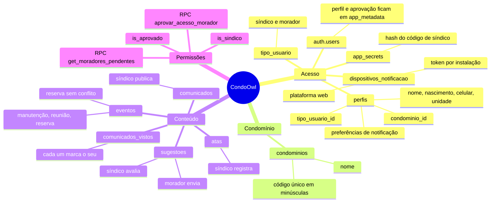
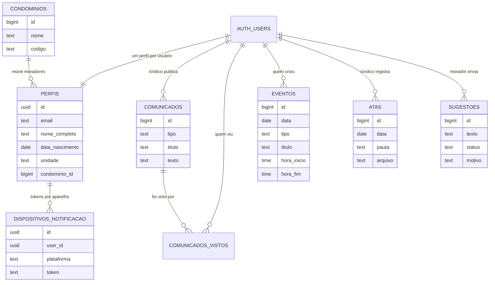
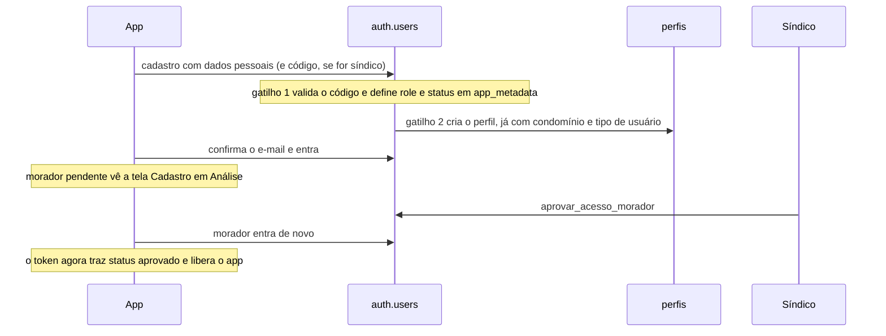

# CondoOwl — Mapa das tabelas do banco

- **Projeto:** CondoOwl (Supabase)
- **Branch:** fix/0001-vulnerabilidade-perfil-aprovacao
- **Migrações:** 0001 a 0016
- **Situação:** esquema validado em Postgres de teste; o app usa o cadastro, a aprovação, os comunicados, as reservas, as sugestões e as atas

## 1. Visão geral

## 2. Como as tabelas se ligam

## 3. Do cadastro ao acesso liberado

## 4. Quem pode fazer o quê

| Tabela | Ler | Escrever |
|--------|-----|----------|
| `perfis` | o próprio usuário; síndico lê todos | usuário altera nome, celular e preferências de notificação |
| `dispositivos_notificacao` | o próprio usuário | usuário registra tokens das instalações do PWA; síndico não lê tokens |
| `tipo_usuario` | qualquer usuário logado | ninguém pela API (só o dono do banco) |
| `condominios` | síndico e moradores aprovados | só síndico |
| `comunicados` | síndico e moradores aprovados | só síndico |
| `comunicados_vistos` | o próprio usuário; síndico | cada um registra o seu |
| `eventos` | síndico e moradores aprovados | síndico cria qualquer tipo; morador aprovado só reserva em seu nome, de hoje em diante |
| `atas` | síndico e moradores aprovados | só síndico |
| `sugestoes` | síndico e moradores aprovados | morador envia como pendente; só síndico avalia |
| `app_secrets` | ninguém pela API | só por SQL, pelo dono do banco |

Quem não está logado (`anon`) não acessa nenhuma tabela. A única coisa que `anon` executa é `validar_codigo_condominio`, que só responde sim ou não.

## 5. Regras que o próprio banco garante

- **Perfil e aprovação** vêm do servidor. O que o usuário escreve em `user_metadata` não vale.
- **Código de síndico errado** recusa o cadastro.
- **Código de condomínio inexistente (ou ausente)** recusa o cadastro; o perfil nasce já ligado ao condomínio.
- **Reserva em conflito** (mesmo espaço, horários que se cruzam) é barrada.
- **Sugestão arquivada** exige motivo.
- **Código do condomínio** é único e só em minúsculas.
- **Condomínio com moradores** não pode ser apagado.

## 6. O que ainda não existe

::: warn
**Dados ainda não separados por condomínio.** Só `perfis` aponta para `condominios`. Comunicados, eventos, atas e sugestões valem para todos, e o síndico enxerga tudo. Separar por condomínio exige `condominio_id` nessas tabelas e ajustar as policies.
:::

- O isolamento por condomínio é só do app: depois do login ele confere o condomínio do usuário (`usuario_pertence_ao_condominio`), mas as policies e RPCs ainda não filtram por `condominio_id`.
- Eventos criados pelo síndico (manutenção e reunião) ainda não têm tela: o calendário lê todos os eventos do banco, mas o app só grava reservas. Tampouco há upload do PDF da ata: a ata guarda o nome ou o link do arquivo.
